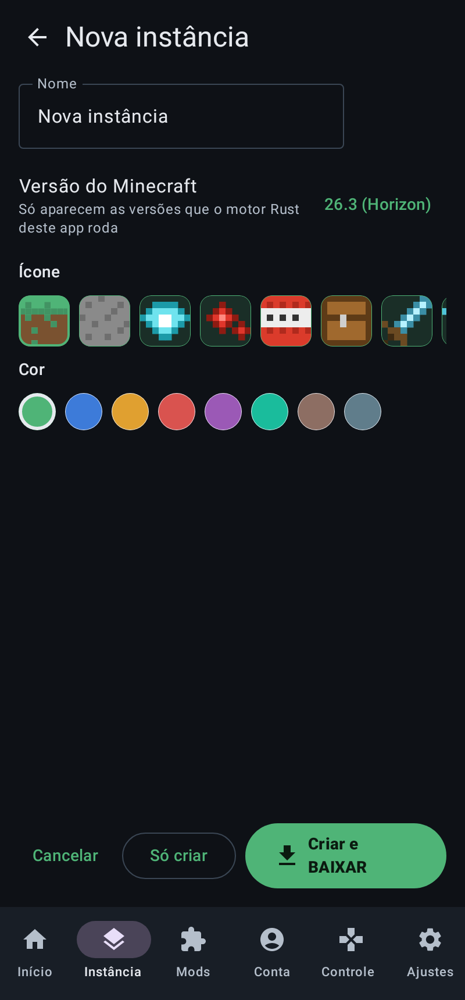

# Zenith Launcher: Minecraft Java no celular, com o Horizon (Rust)

Um launcher para Android no estilo do PojavLauncher, só que em vez de rodar o
Minecraft Java numa JVM ele roda o **[Horizon](https://github.com/horizon-rust/horizon)**,
a reescrita open source em Rust do Minecraft: Java Edition 26.3 (o "Minecraft Rust
Edition"). Não tem JVM, não tem tradução de OpenGL: é código nativo ARM64
desenhando com Vulkan (ou OpenGL ES) pelo wgpu.

> ⚠️ **Estado:** o launcher (interface, contas, skins, instâncias, mods,
> controles, ajustes) compila e roda. O motor do Horizon tem um patch pequeno
> para Android e uma crate de entrada própria. Ele compila no CI
> (`.github/workflows/horizon-android.yml`), mas **ainda não foi testado num
> celular**. Ver [Limitações](#limitações-e-roadmap).

## Telas

Renderizadas pelo Robolectric a partir do código real (`./gradlew testDebugUnitTest -Pzenith.screenshots`):

| Início (BAIXAR) | Nova instância | Conta e skin | Controles | Gráficos |
|---|---|---|---|---|
|  |  |  |  |  |


## O que tem

| Área | O que faz |
|---|---|
| **Início** | Botão Jogar, estado de prontidão (motor, recursos, conta, posse do jogo), continuar mundos recentes, servidor favorito |
| **Instâncias** | Várias pastas de jogo (mundos, opções, packs, mods, prints), com nome, ícone e cor. Também: mundo ou servidor para abrir direto, layout de controles por instância e argumentos extras |
| **Mods** | Instalados (ligar/desligar/apagar) e Explorar: o índice oficial de mods do Horizon, com busca, filtro por tipo, conferência de tamanho e SHA-256 e lista de revogados. Importa `.hmod`, resource packs `.zip` e shaders `.hshader` |
| **Conta** | Login Microsoft por código (Xbox Live → XSTS → Minecraft), conferência de posse do Java Edition, nomes offline, tokens cifrados no Android Keystore |
| **Skin** | Prévia de frente e costas (camadas externas, braço fino ou clássico), escolher PNG 64x64, capa, enviar a skin para a conta Microsoft |
| **Controles** | Joystick analógico (fixo ou flutuante), arrastar para olhar, gestos (tocar = usar, segurar = quebrar), hotbar por toque, correr automático. **Editor de layout** (arrastar, tamanho, rótulo, ação, quando aparece), vários layouts, exportar e importar em JSON. Controle Bluetooth/USB |
| **Ajustes** | API gráfica (Auto, Vulkan ou OpenGL ES), escala de resolução, presets para celular, FPS, distâncias, LOD, qualidade, interface, idioma, som por categoria, recursos do jogo, Client ID do Azure, tema e cor, logs e crashes |
| **API** | Console de comandos dentro do jogo (a API de controle do Horizon), botões que rodam comandos, deep links `zenith://play`, arquivo de lançamento documentado |

## Como funciona

```
 Launcher (Kotlin, processo principal)          Jogo (processo :game)
 ─────────────────────────────────────          ─────────────────────
 Compose UI ── instâncias, contas, mods          HorizonGameActivity (GameActivity)
     │                                              │ carrega libhorizon_android.so
     ├─ escreve files/launch/launch.json ─────────► android_main (Rust, native/)
     │   (argumentos da Launch API do Horizon,      │ stdout/stderr → logcat
     │    ambiente: skin offline, etc.)             │ embed::set_args / set_android_app
     ├─ escreve a sessão (0600, lida e apagada)     ▼
     └─ startActivity ─────────────────────────►  horizon_client::entry::main()
                                                    winit (android-activity) + wgpu (Vulkan/GLES)
 Overlay de toque (View) ── socket Unix ──────►  --control-socket: a API do horizon-ctl
   joystick → "pad stick left x y"                 (key, mouse, pad, mouse-move, select, type,
   olhar   → "mouse-move dx dy"                     state, save, quit, give, tp, …)
   botões  → "key space down", "mouse left up"…
 Menus do jogo ◄── toque passa direto ── winit Touch → mouse (patch embed::touch_as_mouse)
```

- **Por que o socket de controle?** O Horizon já tem uma API de automação
  completa (`horizon-ctl`, docs/agent-control.md no Horizon) com teclado, mouse,
  pad virtual e estado do jogo. Usar essa API deixa o patch no Horizon pequeno
  (~140 linhas) e dá ao launcher um console e botões programáveis sem custo extra.
- **Processo separado:** o jogo roda em `:game`. Sair do jogo encerra o processo
  e libera toda a memória; um crash não derruba o launcher, que mostra o log.
- **Patch no Horizon** (`patches/horizon-android.patch`):
  - `embed.rs`: argumentos vindos do launcher, o `AndroidApp` do winit, toque → mouse;
  - os três `EventLoop::new()` passam por `embed::event_loop()`;
  - `arboard` (área de transferência) fica fora do Android, que não tem backend para ele;
  - a crate `horizon-android` entra no workspace.

## Legal: o que o app traz e o que não traz

O modelo é o do próprio Horizon:

- **Nem o APK nem este repositório têm código, texturas, sons ou dados do
  Minecraft.** O Horizon é uma reimplementação (MIT); o CI confere que o APK não
  leva `.jar`, `.ogg`, regiões nem recursos preparados.
- **Os arquivos do jogo vêm da Mojang, para quem tem o jogo.** O BAIXAR busca os
  arquivos oficiais nos servidores da Mojang só para uma conta Microsoft dona do Java
  Edition (como o launcher do Horizon faz), e eles ficam só no seu celular. Ou você
  prepara no PC a partir da sua cópia e importa o zip.
- **O jogo só abre com uma conta dona do Java Edition**, como o launcher do
  Horizon pede a launchers de terceiros (docs/api/launch.md e
  docs/microsoft-account.md no Horizon). Nomes offline jogam atrás de uma conta
  dona. Há uma chave de desenvolvimento, desligada por padrão, para testar sem
  login.
- Não usa nome, logo nem arte do Minecraft na identidade do app.
- Não é um produto oficial do Minecraft, nem aprovado ou associado à Mojang ou à Microsoft.

## Compilando

Pré-requisitos: JDK 17, Android SDK (plataforma 35) com NDK `27.2.12479018`, Rust
estável com o alvo `aarch64-linux-android` e `cargo-ndk`.

```sh
git clone https://github.com/vitkkk/m64-mobile-port && cd m64-mobile-port

# 1. O motor (Rust): baixa o Horizon fixado, aplica o patch, compila a .so
rustup target add aarch64-linux-android      # + x86_64-linux-android para o emulador
cargo install cargo-ndk
export ANDROID_NDK_HOME=$ANDROID_HOME/ndk/27.2.12479018
horizon-android/tools/build-native.sh                    # release, arm64-v8a
# horizon-android/tools/build-native.sh --abi arm64-v8a,x86_64 --profile fast

# 2. O APK
cd horizon-android
./gradlew assembleDebug -Pzenith.abis=arm64-v8a  # -> app/build/outputs/apk/debug/app-debug.apk
./gradlew testDebugUnitTest                      # testes do launcher

# Login Microsoft: um Client ID do Azure seu, aprovado pela Mojang
./gradlew assembleRelease -Pzenith.msaClientId=<GUID>
```

Sem o passo 1 o APK abre normalmente (dá para explorar e configurar tudo), mas o
botão Jogar avisa que falta o motor. O CI publica o APK completo como artefato
(`zenith-launcher-arm64`).

## Usando

Como no Mojo/Pojav: **Criar instância → escolher a versão → BAIXAR → JOGAR**, tudo no celular.

1. **Conta → Entrar com Microsoft** com a conta que tem o Minecraft: Java Edition.
2. **Instâncias → Nova instância**, versão **26.3 (Horizon)**, **Criar e BAIXAR** (ou o
   **BAIXAR** do Início).
3. Espere a **Instalação concluída** (alguns minutos; dá para sair do app, segue na notificação).
4. **JOGAR**, com a conta Microsoft ou com um nome offline.

### O que o BAIXAR faz

| Etapa | O quê | Conferido por |
|---|---|---|
| Conta | pergunta à Mojang se a conta Microsoft tem o Java Edition (entitlements) | o próprio serviço da Mojang |
| Metadados | JSON da versão buscado **pelo hash fixado** no `research-lock.json` do Horizon (`piston-meta.mojang.com/v1/packages/<sha1>/26.3.json`) e o índice de assets | SHA-1 |
| Arquivos | client e server jar, 114 bibliotecas e os assets que o `horizon-prepare` usa (sons, panorama, fontes, idiomas, packs embutidos): ~5.200 arquivos, ~660 MB, de `piston-data.mojang.com` e `resources.download.minecraft.net`, 8 em paralelo, retomável | SHA-1 de cada arquivo (client e server também contra os hashes do Horizon) |
| Java | OpenJDK 25 para Android (build público do AngelAuraMC, GPLv2+CE), ~38 MB | SHA-256 fixado |
| Preparo | `horizon-prepare --prepare --complete` do Horizon no celular: compila os exportadores do Horizon com o `javac` desse Java e roda o gerador de dados do vanilla com o seu jar | `horizon-prepare --check` |
| Fim | troca segura da pasta de recursos; o Java e os arquivos de trabalho são apagados (os downloads também, a menos que você marque "Guardar") | |

Por que precisa de Java: o Horizon prepara as tabelas do jogo rodando o código da própria
Mojang (os exportadores), e isso só roda numa JVM (issue horizon-rust/horizon#1750). O
`horizon-prepare` vai no APK como `libhorizon_prepare.so`; como o Android só deixa um app executar
programas da pasta de bibliotecas do APK, o Java baixado é iniciado por dois lançadores pequenos
em C que também vão lá (`native/launcher/java_launcher.c`, técnica do Starling). Um patch de 25
linhas no `horizon-prepare` (`HORIZON_PREPARE_JAVA`/`JAVAC`) faz o preparador usar esses lançadores.

**Regras de conta:** os arquivos do jogo só são baixados para uma conta Microsoft que tem o Java
Edition, como o Horizon pede a launchers. Nomes offline são criados e jogam localmente sem
login, depois que o jogo foi instalado. Não há como pular essa verificação para baixar (a chave
de teste em `DevFlags` só vale para abrir o jogo já instalado). O login Microsoft precisa de um
Client ID do Azure aprovado pela Mojang (Ajustes → Conta Microsoft).

### Importar do celular (JAR local ou instalação de outro launcher)

No Início (ou Ajustes → Instalar o jogo), **Importar do celular**:

- **Importar JAR local**: escolha o `26.3.jar` no seletor do Android (ex.:
  `MJLauncher/.minecraft/versions/26.3/26.3.jar`). O Zenith lê o `version.json` de dentro do JAR,
  vê se é client ou servidor e confere o SHA-1 contra o que o Horizon fixa. JARs de outra versão
  ou modificados (Fabric, Forge, OptiFine, patches) são recusados com o motivo.
- **Importar instalação existente**: escolha a pasta `.minecraft`, a pasta do launcher que a
  contém ou a pasta da versão. O Zenith acha `versions/26.3/26.3.json` e `.jar`, `libraries/` e
  `assets/`, copia o que o `horizon-prepare` usa e confere cada arquivo pelo hash; o que não
  confere fica de fora e é listado. Não precisa de permissão de armazenamento (Storage Access
  Framework); pastas dentro de `Android/data` de outros apps o Android não deixa abrir.
- A lista **O que o Horizon precisa** mostra o que está pronto e o que falta:

  | Item | Obrigatório | De onde |
  |---|---|---|
  | JSON da versão | sim | **Importar .json** (o `26.3.json` da `.minecraft/versions/26.3/`) ou **Buscar o JSON na Mojang** (alguns KB, pelo hash fixado; buscado sozinho depois de importar o JAR). A Mojang republicou o JSON do 26.3 em 10/11/2026 (`9f67e10…`, só o índice de traduções muda) e este Horizon só aceita os anteriores: um launcher com o mais novo precisa da busca |
  | Client 26.3 | sim | JAR local ou instalação |
  | **Servidor 26.3** | sim | o `horizon-prepare` roda o gerador de dados dele, e launchers de celular não o guardam: selecione o `server.jar` (minecraft.net) ou use o BAIXAR |
  | Bibliotecas do client | sim | da instalação (launchers Android às vezes trocam as do LWJGL: o BAIXAR completa) |
  | Assets | não | da instalação; sem eles o jogo fica mudo e só em inglês |
  | Java 25 | sim | baixado do GitHub (~38 MB) ou importado (`.tar.xz` fixado) |

- **PREPARAR E INSTALAR** só fica ativo quando o obrigatório está lá; roda o mesmo preparo do
  BAIXAR (com `--complete` se os assets estiverem todos) e só marca o jogo instalado depois que o
  `horizon-prepare --check` e a validação do Zenith passam.
- O **BAIXAR** reaproveita o que foi importado e baixa só o que falta.

Um JAR no celular não prova que você tem o jogo: abrir a partida continua pedindo a conta
Microsoft dona do Java Edition (ou a chave de teste temporária).

### Alternativa avançada: preparar no PC e importar o ZIP

Para quem já tem os recursos preparados (ou não quer baixar no celular):
```sh
horizon-android/tools/prepare-resources.sh --server-jar ~/Downloads/server.jar
# -> horizon-resources.zip (centenas de MB; é seu, não compartilhe)
```
No **Windows**: dois cliques em `horizon-android\tools\PREPARAR-RECURSOS.bat`. Depois, no
celular: **Ajustes → Instalar o jogo → Importar .zip**.

Dicas de desempenho: o preset **Equilibrado** (8 chunks, 60 FPS, resolução 85%) é
o padrão das instâncias novas. Em aparelhos com Vulkan problemático use
**OpenGL ES** em Ajustes → Gráficos → API gráfica.

## A API

| Superfície | Como |
|---|---|
| Console no jogo | Ajustes → Avançado e API → Console; depois ☰ no jogo. Qualquer comando do `horizon-ctl`: `state`, `give diamond 3`, `time 6000`, `options-set renderDistance 6`, `screenshot /sdcard/...`, `bench 10`… |
| Botões programáveis | No editor de controles, tipo "Comando da API": um comando ao apertar, outro ao soltar |
| Deep links | `zenith://play?instance=ID&world=PASTA` · `zenith://play?server=host:25565` (pede confirmação, a não ser que você confie) |
| Arquivo de lançamento | `files/launch/launch.json` (`version`, `game_dir`, `args`, `env`), lido pelo `android_main`; `files/launch/exit.json` ao terminar |
| Layouts | JSON exportável (`version`, `joystick`, `buttons[]` com `x`/`y` 0..1, `size` em dp, `action` `{type: KEY|MOUSE|PAD|COMMAND|SPECIAL, value, release}`) |

## Estrutura

```
horizon-android/
  app/                       o launcher (Kotlin, Jetpack Compose) e a tela do jogo
    src/main/java/io/github/zenith/
      auth/                  login Microsoft (código de dispositivo)
      data/                  pastas, instâncias, contas, opções, recursos, mods, skins
      controls/              layouts, overlay de toque, editor
      game/                  GameActivity, socket de controle, lançamento
      ui/                    telas
  native/                    crate horizon-android: android_main, logcat, launch.json
  patches/horizon-android.patch
  third_party/horizon        submódulo (horizon-rust/horizon, commit fixado)
  tools/build-native.sh      Horizon → libhorizon_android.so
  tools/prepare-resources.sh recursos da sua cópia → zip para importar
```

## Limitações e roadmap

- [x] Launcher completo: instâncias, contas Microsoft e offline, skins, mods, controles editáveis, ajustes, logs, API
- [x] Crate de entrada Android + patch do Horizon (winit/GameActivity, argumentos, toque nos menus)
- [x] CI que compila o motor para arm64 e empacota o APK
- [ ] **Testar num celular de verdade** (Adreno, Mali, Xclipse) e corrigir o que aparecer
- [ ] Voltar ao jogo depois de sair do app (recriar a superfície do wgpu em `resumed`); hoje o mundo é salvo ao sair
- [x] Instalar o jogo no próprio celular: download oficial da Mojang + preparo com Java 25 temporário
- [ ] Testar o instalador num celular de verdade (compila e passa nos testes; o preparo com o Java no Android ainda não rodou num aparelho)
- [ ] Área de transferência do Android no jogo (hoje copiar e colar funcionam só dentro do jogo)
- [ ] Mods nativos (`.hnmod`): compilar motores com eles no CI e importar no app
- [ ] Teclado na tela integrado ao GameTextInput do GameActivity
- [ ] x86_64 (emulador) no CI

## Créditos

- [Horizon](https://github.com/horizon-rust/horizon), de Ludovic Marie e colaboradores (MIT)
- [winit](https://github.com/rust-windowing/winit), [wgpu](https://github.com/gfx-rs/wgpu), [android-activity](https://github.com/rust-mobile/android-activity), [GameActivity](https://developer.android.com/games/agdk/game-activity)
- [Starling](https://github.com/starling-client/starling) (MIT), o port Android do Horizon: a técnica de
  preparar no celular com um Java baixado e lançadores na pasta de bibliotecas veio dele
- OpenJDK 25 para Android do [AngelAuraMC](https://github.com/AngelAuraMC/angelauramc-openjdk-build)
  (GPLv2 com Classpath Exception): baixado na instalação, conferido por SHA-256, não vai no APK
- Inspirado por PojavLauncher, MojoLauncher e afins

Licença do Zenith: GPL-3.0, como o resto do repositório. O Horizon mantém a dele (MIT).
