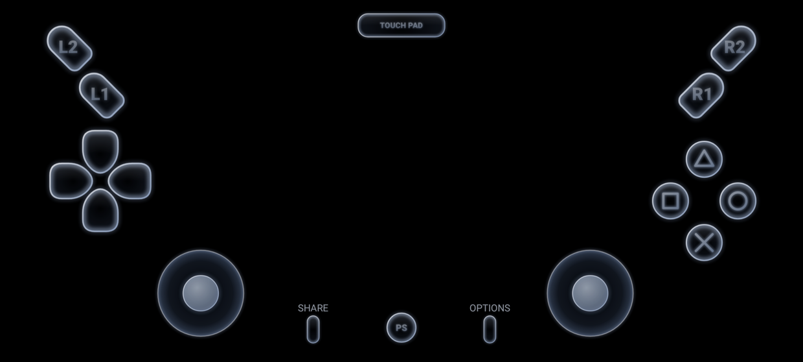
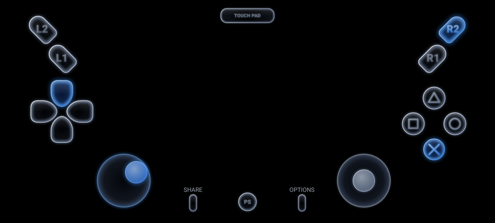

# PPSS55 — emulador experimental de PlayStation 5 para Android

PPSS55 é um port Android **baseado no núcleo real do [KytyPS5-Android](https://github.com/tarek369/KytyPS5-Android)**
(fork Android do [KytyPS5](https://github.com/KytyPS5/KytyPS5), que por sua vez vem do
[Kyty](https://github.com/InoriRus/Kyty)). O código x86-64 dos jogos roda no tradutor dinâmico
[FEXCore](https://github.com/FEX-Emu/FEX) dentro do processo, e os comandos da GPU do PS5 são traduzidos
para Vulkan (Adreno, com o driver Mesa Turnip carregado via libadrenotools).

Esta pasta é um projeto separado do port de N64 que vive no restante deste repositório.

> ⚠️ **Estado honesto (Etapa 1):** o APK compila com o núcleo real e instala, mas **nada foi executado
> num celular ainda** — o ambiente de desenvolvimento não tem aparelho ARM64 nem emulador Android ARM64.
> Nenhuma afirmação de jogo rodando no REDMAGIC 9S Pro é feita aqui. Os resultados de compatibilidade
> exibidos no app são os medidos pelo projeto KytyPS5-Android num Adreno 830, marcados com `*`.

## Por que este núcleo

| Projeto | Situação verificada no código (out/2026) | Decisão |
|---|---|---|
| **tarek369/KytyPS5-Android** (GPL-2.0, branch `android-boot-wip`, commit `9ab8b82`) | CMake completo para NDK, FEX fixado num commit com patches Android, launcher Kotlin, controles na tela, 163 testes JVM, auto-teste de CPU x86-64 embutido (`--fex-selftest`) | **Base do PPSS55** (submódulo `core/`) |
| KytyPS5/KytyPS5 | Desktop (Windows/Linux/macOS), sem alvo Android | Upstream do anterior |
| InoriRus/Kyty | Projeto original (MIT), inativo, PS4/PS5 iniciais | Referência histórica |
| shadPS4 | Emulador de PS4 maduro, mas x86-64 nativo no desktop; sem port Android oficial | Não integrado (ver Etapa 3) |

O núcleo foi compilado aqui **de verdade**, do zero: FFmpeg para Android, FEXCore (ExternalProject com os
patches `fex-android.patch` e `fex-addressfold.patch`) e o Kyty, 1031 alvos com NDK 28.2 → `libmain.so`
ARM64 (357 MB com símbolos, 37 MB sem).

## O que o PPSS55 muda em relação ao app do KytyPS5-Android

- **Controles virtuais no estilo da referência (DualSense em vidro escuro):** `GlassRenderer.kt` +
  `TouchControllerView.kt`. Contorno branco-azulado com degradê, glow discreto, sombreamento interno,
  brilho superior; ao tocar, contorno fica azul, glow e sombreamento interno se acendem, com animação
  (ataque ~28 ms, retorno ~110 ms). Sprites pré-renderizados e só cruzados por alfa no desenho; a entrada
  é enviada no `onTouchEvent`, antes de qualquer desenho, então a animação não adiciona latência.
  Layout padrão igual à imagem (L1/L2 e R1/R2 inclinados, D-pad em pétalas, faces à direita, analógicos
  embaixo, SHARE / PS / OPTIONS no centro inferior, touchpad no topo). Novos: **PS** (abre o menu do
  emulador) e **SHARE** (captura real do quadro via `PixelCopy`). No PS5 esses dois botões são do sistema
  e os jogos não os recebem — por isso não são enviados ao jogo.
- Opacidade 0–100 %, tamanho individual e global, arrastar cada controle, ocultar/mostrar (L3/R3 começam
  ocultos, como na imagem), salvar layout por jogo ou como padrão, multitoque, esconder tudo.
  Controles físicos Bluetooth/USB continuam via SDL3 (o overlay some sozinho quando há gamepad).
- **Launcher escuro e minimalista em português**, tela de boas-vindas, seletor de pastas do Android (SAF)
  com a permissão **persistida** (`takePersistableUriPermission`) e o caminho salvo; trocar pasta depois.
- **Diagnóstico com dados reais do aparelho** (`src/main/cpp/probe.cpp`): versão Vulkan da instância e
  do dispositivo, nome da GPU, driver, memória local, CPU (núcleos, MHz, recursos ARM que o FEX usa:
  LSE, RCpc, FlagM, AFP…), RAM. Botão que faz `dlopen` do `libmain.so` e mostra o `dlerror()` real.
- **Auto-teste de CPU x86-64 (FEXCore)** a partir do app: roda `Cpu::GuestCpu::RunGuestCpuSelfTest`
  (código x86-64 montado à mão: aritmética, chamadas HLE, callback host→guest, falha de página tratada)
  e lê o resultado `FEX-SELFTEST DONE passed=… failed=…` do log do núcleo.
- Jogo em processo separado (`:game`): se o núcleo travar ou encerrar, o launcher sobrevive e mostra o log.
- Configurações: resolução de saída, **resolução interna 25/50/75/100 %** (`--render-scale`, o núcleo aceita
  0,25–2,0), modo de apresentação (VSync = único limite de FPS que o núcleo tem; não há limitador
  próprio e o app não finge ter), cache de shaders em disco, HUD de FPS/frame time (valores do próprio
  núcleo), `--perf-stats`, turbo da GPU, seleção de driver Vulkan (Turnip v32 embutido + importar zip).
  Por jogo: controles, resolução, escala, driver, presets e variáveis `KYTY_*` (do app original).
- Biblioteca: só os formatos que o núcleo lê — pasta extraída com `sce_sys/param.json`, imagem `.exfat`,
  arquivo `.zar`. Nome, ícone (`icon0.png`), Title ID e status de compatibilidade.




As duas imagens acima são renderizadas pela própria `TouchControllerView` (Robolectric, gráficos nativos,
2480×1116 = tela do REDMAGIC 9S Pro em paisagem) no teste `ControllerScreenshotTest`.

## Compilar

Pré-requisitos: Linux x86-64, JDK 17+, Android SDK (platform 36), NDK `28.2.13676358`, CMake ≥ 3.22,
Ninja, `glslangValidator`, ccache (opcional). A CI faz exatamente isto: `.github/workflows/ppss55.yml`.

```sh
git submodule update --init ppss55/core
git -C ppss55/core submodule update --init --recursive --depth 1

export ANDROID_NDK=$ANDROID_SDK_ROOT/ndk/28.2.13676358
ANDROID_NDK_HOME=$ANDROID_NDK bash ppss55/core/scripts/android/build-ffmpeg-android.sh $PWD/_Build/ffmpeg-android
cmake -S ppss55/core -B _Build/android -G Ninja \
  -DCMAKE_TOOLCHAIN_FILE=$ANDROID_NDK/build/cmake/android.toolchain.cmake \
  -DANDROID_ABI=arm64-v8a -DANDROID_PLATFORM=android-31 -DCMAKE_BUILD_TYPE=Release \
  -DKYTY_GUEST_CPU_FEX=ON -DKYTY_BUILD_LAUNCHER=OFF \
  -DFFMPEG_PREBUILT_DIR=$PWD/_Build/ffmpeg-android/install
ninja -C _Build/android kyty_emulator          # ~1 h em 4 núcleos

ST=ppss55/build-native; mkdir -p $ST/3rdparty/SDL3 $ST/3rdparty/libadrenotools/src/hook
$ANDROID_NDK/toolchains/llvm/prebuilt/linux-x86_64/bin/llvm-strip --strip-debug -o $ST/libmain.so _Build/android/libmain.so
cp _Build/android/3rdparty/SDL3/libSDL3.so $ST/3rdparty/SDL3/
cp _Build/android/3rdparty/libadrenotools/src/hook/*.so $ST/3rdparty/libadrenotools/src/hook/

cd ppss55/android && ./gradlew testDebugUnitTest assembleDebug -PkytyNativeDir=$PWD/../build-native
# -> ppss55/android/app/build/outputs/apk/debug/app-debug.apk
```

Se o Maven Central responder 429, use `-ProbolectricRepo=<espelho Maven>` para os testes Robolectric.

## Instalar e testar no REDMAGIC 9S Pro

1. Baixe o artefato `ppss55-debug-apk` da CI (ou compile). Ative *Opções do desenvolvedor → Depuração USB*.
2. `adb install -r app-debug.apk` (ou abra o APK no aparelho e permita "instalar apps desconhecidos").
   O pacote é `com.ppss55.emu`; convive com o KytyPS5 original.
3. Na boas-vindas, conceda **acesso a todos os arquivos** e escolha a pasta de jogos (ex.: `PPSS55/games`).
4. **Diagnóstico** → confira GPU "Adreno (TM) 750", Vulkan 1.3, recursos ARM, e toque em
   *Testar carregamento do núcleo* (deve dizer `loaded=libmain.so`, `SDL_main: ok`).
5. **Auto-teste da CPU x86-64 (FEXCore)**: abre a tela de jogo, roda e volta mostrando `PASSOU`/`FALHOU`.
6. Copie um jogo seu (pasta extraída ou `.exfat`) para a pasta, toque nele. Se não iniciar,
   *Diagnóstico → Ver log da última sessão* (o log também vai para a área de transferência).
   `adb logcat -s Kyty SDL KytyPS5` mostra o mesmo log ao vivo.

Pontos a observar no 9S Pro (Adreno 750 não foi testado por ninguém ainda): o driver padrão é o Turnip
mainline v32 embutido; se falhar, troque para o driver do sistema nas Configurações. A memória é o limite
principal (o upstream mede ~13 GB para Astro Bot); o 9S Pro tem de 12 a 24 GB conforme a versão.

## O que foi realmente testado (neste ambiente, sem aparelho)

| Item | Como | Resultado |
|---|---|---|
| Núcleo nativo (FEXCore + Kyty + SDL3 + adrenotools) compila para arm64-v8a | `ninja kyty_emulator`, NDK 28.2 | ✅ 1031/1031 alvos, `libmain.so` exporta `SDL_main` |
| Sonda nativa (`libppss55_probe.so`) compila | Gradle `externalNativeBuild` | ✅ |
| Testes JVM do app (biblioteca, SFO, layout/hit-test dos controles, sem sobreposição de 20:9 a 4:3, presets, drivers…) | `./gradlew testDebugUnitTest` | ✅ 163 + teste de captura dos controles, 0 falhas |
| Controles: desenho e mudança de estado ao pressionar | `ControllerScreenshotTest` (Robolectric, renderização nativa) | ✅ imagens acima; Cruz/↑ chegam ao `PadState` |
| APK de debug instalável | `assembleDebug`, `apksigner verify` | ✅ `com.ppss55.emu`, 17,5 MB, assinado (debug), contém `libmain.so` |
| Abrir no Android, seletor de pastas, Vulkan real, carregar núcleo, auto-teste FEX, jogos | precisa de aparelho | ❌ **não testado** |

## Roadmap

- **Etapa 1 (este commit):** APK com núcleo real, diagnóstico, SAF, controles. Falta validar no aparelho.
- **Etapa 2:** rodar o auto-teste FEX no 9S Pro; depois um homebrew PS5 simples (ELF/SELF não
  criptografado em pasta com `sce_sys/param.json`) — imagem, entrada, áudio (o núcleo usa SDL3 audio)
  e encerramento limpo. Nenhum homebrew é distribuído; precisa ser fornecido pelo usuário.
- **Etapa 3:** jogos leves já relatados pelo upstream (Vampire Survivors). *Sonic Mania* é jogo de PS4:
  o KytyPS5 carrega só executáveis de PS5 (prospero); suporte PS4 exigiria integrar o HLE de bibliotecas
  PS4 (orbis) e o recompilador de shaders GCN do shadPS4, que é x86-64-only no desktop — viável só como
  projeto grande e separado, não nesta etapa.
- **Etapa 4:** perfis por jogo medidos no 9S Pro, shaders, paralelismo, memória.

## Licenças e legalidade

- `core/` é o KytyPS5-Android sem modificações, GPL-2.0 (ver `core/LICENSE` e `core/LICENSES/`).
- `android/` é derivado do app do KytyPS5-Android e continua GPL-2.0 (`LICENSE` nesta pasta);
  os créditos de Dolphin/Vita3K/RPCSX nos cabeçalhos foram mantidos.
- Este projeto não distribui jogos, firmware, chaves nem software da Sony e não é afiliado à Sony.
  "PlayStation" e "PS5" são marcas da Sony Interactive Entertainment, citadas apenas para descrever
  compatibilidade. O botão PS dos controles usa o texto "PS", não o logotipo.
